<p align="center"></p>

<p align="center"><a href="docs/REPO_MIRROR_INDEX.md">PUBLIC PROJECT MAP</a> &nbsp;·&nbsp; <a href="SPECIALIST_REPOSITORIES.md">SOURCE REPOSITORIES</a> &nbsp;·&nbsp; <a href="https://github.com/reggaesharkk">PROFILE</a> &nbsp;·&nbsp; <a href="https://orcid.org/0009-0002-1170-4487">ORCID</a></p>

# Reggae Shark Universe

**Prince Upadhyay · Independent Researcher · India**  
[ORCID 0009-0002-1170-4487](https://orcid.org/0009-0002-1170-4487) · [GitHub profile](https://github.com/reggaesharkk) · [Contact](mailto:starxshark@gmail.com)  
**Updated:** 4 November 2026 (Navier–Stokes status addendum) · **Method:** Build · Attack · Falsify · Preserve

> *I follow the question until the evidence draws a line.*

I work across mathematical dynamics, spectral methods, formal reasoning, AI evaluation, and verifiable software. This repository is the public map and archival record. The work itself lives in the specialist repositories below, each with its own history and stated limits.

**Current-status note:** The Navier–Stokes [4 November evidence timeline](papers/navier-stokes/NAVIER_STOKES_EVIDENCE_TIMELINE_2026_11_04.md) supplements the historical executive map below, which remains the 26 October 2026 snapshot.

## The public work

| Project | Area | What the evidence says |
|---|---|---|
| [Physics · dynamical sector](https://github.com/reggaesharkk/physics-v1-dynamical-sector) | Mathematical dynamics | Model-specific dynamical-sector and stability work. The observer-to-horizon bridge remains open. |
| [Ψ Self-Modeling Benchmark](https://github.com/reggaesharkk/psi-self-modeling-benchmark) | AI evaluation | Diagnostic self/peer benchmark. It does not establish consciousness or general self-awareness. |
| [Navier–Stokes Bridge Audit](https://github.com/reggaesharkk/navier-stokes-bridge-audit) | Validated computation | Archived finite Fourier–Galerkin records; the current package replay checks supplied records, while full-path transfer and continuum regularity remain open. [4 November evidence timeline](papers/navier-stokes/NAVIER_STOKES_EVIDENCE_TIMELINE_2026_11_04.md). |
| [Self-Referential Processing Design Lab](https://github.com/reggaesharkk/self-referential-processing-designlab) | Experimental design | Preregistered design and simulation validation; confirmatory collection is paused. |
| [LRSC Odd-Ring Spectral Rank](https://github.com/reggaesharkk/lrsc-odd-ring-spectral-rank) | Spectral methods | Scoped odd-ring spectral-rank result and finite eleven-channel certificate. |
| [IntentSeal](https://github.com/reggaesharkk/intentseal) | Verification tooling | Prototype for claim boundaries, evidence provenance, and verification status. |
| [Riemann Bandwidth-One Verification](https://github.com/reggaesharkk/riemann-bandwidth1-verification) | Computational number theory | Finite-band certificates and conditional analyses; the Riemann Hypothesis remains open. |
| [STRENGTH-B3 Interceptor Core](https://github.com/reggaesharkk/STRENGTH-B3-Interceptor-Core) | AI systems | Windows ARM64 interceptor prototype; claims remain bounded by the repository’s measured scope. |
| [Strength Intent · Lean](https://github.com/reggaesharkk/strength-intent-ns-lean) | Formal methods | Separate Lean-oriented companion in the STRENGTH research line; see its repository for current scope. |
| [Theory of Bounded Existence](https://github.com/reggaesharkk/theory-of-bounded-existence) | Mathematical modeling | Model-specific 4D ODE system and formal artifacts; no physical or consciousness claim. |
| [The Reggae Shark Protocol](https://github.com/reggaesharkk/The-Reggae-Shark-Protocol) | Execution evidence | Application-level verification and signed execution evidence prototype. |
| [SharkLang v2.4.2](https://github.com/reggaesharkk/sharklang-v2.4.2-release) | Governed AI | Approval-gated policy-language/runtime release with an explicit evaluation boundary. |
| [SharkLang Evidence Desk](https://github.com/reggaesharkk/sharklang-evidence-desk) | Release auditing | Local ZIP structure and checksum review; it does not execute archive contents. |

The boundaries matter. Finite certificates remain finite. Simulations do not become observations. Prototypes do not become production security guarantees by presentation alone. The linked repositories state their assumptions, evidence, and open obligations.

## One map. Independent source histories.

I pin the public project repositories and my profile as Git submodules, so this Umbrella can point to exact source commits without flattening each project’s history.

```sh
git clone --recurse-submodules https://github.com/reggaesharkk/Reggae-shark-universe-.git
```

If the Umbrella is already cloned:

```sh
git submodule update --init --recursive
```

GitHub’s ordinary “Download ZIP” does not include submodule file contents. Use the recursive clone command above to retrieve every pinned public source tree. The current complete list and commit pins are in [the live repository map](docs/REPO_MIRROR_INDEX.md). Private repositories remain private and are excluded.

## How to read this archive

I preserve the dated dossier, evidence standards, and release records below as historical material. Those snapshots are useful for provenance; the current repository map above is the live guide to the public source set.

### Collaboration

I value collaboration that begins with a real question, a careful challenge, or another set of eyes. If one of these projects intersects with your work, I welcome a thoughtful note. The repositories show what is established, what is only a prototype, and what remains open.

**Contact:** [starxshark@gmail.com](mailto:starxshark@gmail.com)

---

## Master Research Dossier & Umbrella Standards

- **Consolidated Master Dossier (Programs 01–09):** [`docs/research/Prince_Upadhyay_Master_Research_Dossier_2026-10-24.pdf`](docs/research/Prince_Upadhyay_Master_Research_Dossier_2026-10-24.pdf) (21 pages, `1,127,453` bytes, SHA-256: `3e05c82a3b478a7c15cf510946f4a8a9ad2c929cc1125494d9704966805dc41b`)
- **The Reggae Shark Protocol `v1.3.2` Specification (Program 10 Mirror):** [`docs/research/The_Reggae_Shark_Protocol_v1_3_2_Specification.pdf`](docs/research/The_Reggae_Shark_Protocol_v1_3_2_Specification.pdf) (3 pages, linearized `%PDF-1.4`, `405,584` bytes, SHA-256: `2741d42d619e1037ffd7d00c74ba6f3902cf235d634e6b86bfb6108276688e6f`) alongside the full 31-file source mirror in [`protocols/shark_protocol_v1_3_2/`](protocols/shark_protocol_v1_3_2/).
- **Previous Dossier Editions Preserved in Git History:** `docs/research/Prince_Upadhyay_Complete_Research_Dossier_Oct2026.pdf` (9 Oct 2026, 19 pages) and `Prince_Upadhyay_Master_Research_Dossier_2026-10-01.pdf` (1 Oct 2026, 11 pages).
- **Companion Umbrella Standards & Machine-Readable Registry:**
  - [`RESEARCHER_AND_ARCHIVE_INDEX_2026_10_25.md`](RESEARCHER_AND_ARCHIVE_INDEX_2026_10_25.md) (supersedes `RESEARCHER_AND_ARCHIVE_INDEX_2026_10_24.md` and `RESEARCHER_AND_ARCHIVE_INDEX_2026_10_11.md` additively; indexes `15` OSF DOIs [`13` ORCID-indexed + `2` companion project archives], `17` Zenodo DOIs [`15` version deposits + `2` Concept DOIs], and `10` GitHub repositories)
  - [`PORTFOLIO_EVIDENCE_AND_RIGHTS_STANDARD_2026_10_25.md`](PORTFOLIO_EVIDENCE_AND_RIGHTS_STANDARD_2026_10_25.md) (supersedes `PORTFOLIO_EVIDENCE_AND_RIGHTS_STANDARD_2026_10_24.md` and `PORTFOLIO_EVIDENCE_AND_RIGHTS_STANDARD_2026_10_01.md` additively)
  - [`registry.json`](registry.json) & [`tools/check_umbrella_registry.py`](tools/check_umbrella_registry.py) (automated single-source-of-truth verifier for cross-repository counts, DOIs, and SHA-256 digests)

---

## Executive Map of the Ten Research Programs — 26 October 2026 snapshot

| # | Program | Core Technical Object | Current Verified State (26 Oct 2026) | Evidence Class | Canonical Repository & Primary DOIs |
|---|---|---|---|---|---|
| **01** | **Self-Referential Processing + Design Lab** | Preregistered 260-item, 20-model behavioral protocol (`v8.6.3`) + Phase 7 GLMM architecture validation (`4,000` fits across `500` deterministic replicates) | Phase 7 complete (`M1` passes locked null/coverage screen: `6.6%`/`6.4%` Type-I, `93.4%`/`93.6%` coverage; `M2` fails); `v8.6.3` live confirmatory collection paused/fail-closed | `PREREGISTERED` / `SIMULATED` | [GitHub](https://github.com/reggaesharkk/self-referential-processing-designlab) · [OSF 37H2Y](https://doi.org/10.17605/OSF.IO/37H2Y) · [OSF NV7DZ](https://doi.org/10.17605/OSF.IO/NV7DZ) |
| **02** | **Psi ($\Psi$) Self-Modeling Benchmark** | Controlled deterministic self-vs-peer 2AFC diagnostic benchmark (`p = 0.50` baseline) with style/length/anonymization controls | `v4` pre-confirmatory diagnostic complete; additive hash audit preserves original OSF manifest | `DIAGNOSTIC` / `PREREGISTERED` | [GitHub](https://github.com/reggaesharkk/psi-self-modeling-benchmark) · [OSF N3DQU](https://doi.org/10.17605/OSF.IO/N3DQU) · [OSF 8CFQW](https://doi.org/10.17605/OSF.IO/8CFQW) · [OSF CAE2H](https://doi.org/10.17605/OSF.IO/CAE2H) |
| **03** | **Information-Theoretic Physics & Appendix A v1.5** | 3D open-loop $(\gamma, H, \dot{I})$ dynamical sector, exact 93/28-monomial Hopf positivity (`l_1 > 0`), and Soft-Wall $(\gamma_{\max}, H_{\max})$ dissipative completion | Appendix A `v1.5` certified (`12/12` checks, Lean 4 6-face box invariance, VRK digest `5eb316f2...`); Gate 0 observer-horizon bridge `OPEN` | `PROVED / ANALYTIC` + `CERTIFIED` | [GitHub](https://github.com/reggaesharkk/physics-v1-dynamical-sector) · [Zenodo 23534449](https://doi.org/10.5281/zenodo.23534449) · [OSF TSW4B](https://doi.org/10.17605/OSF.IO/TSW4B) · [OSF U7M6H](https://doi.org/10.17605/OSF.IO/U7M6H) |
| **04** | **LRSC Odd-Ring Spectral Rank** | Single-step near-Nyquist odd-ring operator $\operatorname{rank}(V) = p$ theorem (`v1.2`/`v1.2.2`) + exact $M=99$ subset threshold certificate | Analytic $\operatorname{rank}(V)=p$ theorem proved (`p=41` at $M=99$); `13,432,735,555` subsets enumerated through $K=10$ certifying $K_{0.001}(0.50)=11$ (`margin 409,802,479`) | `PROVED / ANALYTIC` + `CERTIFIED` | [GitHub](https://github.com/reggaesharkk/lrsc-odd-ring-spectral-rank) · [OSF NM5BW](https://doi.org/10.17605/OSF.IO/NM5BW) · [OSF QJFR3](https://doi.org/10.17605/OSF.IO/QJFR3) · [OSF JAK5X](https://doi.org/10.17605/OSF.IO/JAK5X) |
| **05** | **Navier–Stokes Finite-to-Continuum Bridge Audit** | Unforced periodic 3D Navier–Stokes Fourier–Galerkin audits (`WP1–WP19`), prospective K36 gates, and 128-bit Arb same-datum certificates | Certified `N=11..18` same-datum chain (`max error 0.000013774643`); `N17` failed mechanism gate preserved; `WP19 v0.28` adjoint sign fixed; continuum bridge `OPEN` | `CERTIFIED` (finite) / `FALSIFIED` (N17 gate) / `OPEN` (continuum) | [GitHub](https://github.com/reggaesharkk/navier-stokes-bridge-audit) · [Zenodo 22939984](https://doi.org/10.5281/zenodo.22939984) · [Zenodo 23034545](https://doi.org/10.5281/zenodo.23034545) |
| **06** | **IntentSeal + Verifiable Research Kernel (VRK v0.3.1)** | Fail-closed evidence packaging, dual-seal promotion gates, and deterministic claim-boundary verification | IntentSeal prototype freeze (`05ba923c...`) + VRK `v0.3.1` (`c18c4c69...`, `30/30` tests pass, `33/33` adversarial cases rejected) | `CERTIFIED` (software verification infrastructure) | [GitHub](https://github.com/reggaesharkk/intentseal) · [Zenodo 23016445](https://doi.org/10.5281/zenodo.23016445) · [Zenodo 23018459](https://doi.org/10.5281/zenodo.23018459) · [Zenodo 23474505](https://doi.org/10.5281/zenodo.23474505) |
| **07** | **Riemann Bandwidth-One Verification (WP84)** | Discrete Loewner $C^2$ band-truncation theorem (constant `12`), 150-term $C_5$ polyhedral sign certificate, and order-4 filtered counterexamples | Public release `v0.1.0` (`6d799bdd...`, `21/21` CI jobs pass in Run `#37810408337`); `68.820273%` conditional; `79.627%` model consumer; strict `>79%` and RH `OPEN` | `PROVED / ANALYTIC` + `CERTIFIED` (finite) / `OPEN` (zeta limit) | [GitHub](https://github.com/reggaesharkk/riemann-bandwidth1-verification) · [Zenodo 23244818](https://doi.org/10.5281/zenodo.23244818) · [Zenodo 23244817](https://doi.org/10.5281/zenodo.23244817) |
| **08** | **The Theory of Bounded Existence (Appendix B v1.0)** | 4D closed-loop observer ODE $(\gamma, H, \dot{I}, \Psi)$, 17-theorem Lean 4 point-wise boundary suite, exact rational Hopf monotonicity ($de_c/d\mathcal{P}_0 > 0$), and $\Psi$-memory bistability at $\mathcal{P}_0=0$ | Release `v1.0.0` (commit `c690801`, CI Run `#6` green, Reproducibility Digest `80e0724e...`); $\lambda_{\mathrm{lucid},c}(x_0) \approx 0.080341 \to 0.057974$ (`-27.8%`); non-trivial Floquet multipliers `< 10^-8` | `PROVED / ANALYTIC` + `CERTIFIED` (ODE model) | [GitHub](https://github.com/reggaesharkk/theory-of-bounded-existence) · [Zenodo 23608244](https://doi.org/10.5281/zenodo.23608244) |
| **09** | **STRENGTH H4-BRIDGE-1 Audit & Attack Board v0.6** | Exact BPTT gradient audit (`RNN16`/`GRU9`), $D-2$ causal marker SNR collapse, Sheppard's orthant theorem, and Seven-Problem Attack Board `v0.6` | `100` recurrent networks audited (`< 10^-9` finite-difference match); naive $D-2$ marker falsified (`r = -0.023`); prospective LOSO H4 gate & 7 Clay/physics bridges `OPEN` | `PROVED / ANALYTIC` + `FALSIFIED` (naive marker) + `OPEN` | Tracked in [`docs/research/Prince_Upadhyay_Master_Research_Dossier_2026-10-24.pdf`](docs/research/Prince_Upadhyay_Master_Research_Dossier_2026-10-24.pdf) |
| **10** | **The Reggae Shark Protocol (`v1.3.2`)** | 4-layer application verification kernel & multi-tenant AI gateway: Ed25519-signed VRK hash chain & associative Merkle-DAG join, 16-theorem Lean 4 typestate trace FSM (`runTrace`), 4D soft-wall ODE governor (`42` total zero-`sorry` Lean 4 theorems), and bandlimited LRSC $11/99$ context commitment | Release `v1.3.2` (`31` tracked files, `30/30` manifest SHA-256 checks pass, `42/42` unit & verification tests pass, `42` zero-`sorry` Lean 4 theorems across `3` proof modules + `AxiomsCheck.lean` gate) | `PROVED / ANALYTIC` (Lean 4 model) + `CERTIFIED` (application kernel) | [GitHub](https://github.com/reggaesharkk/The-Reggae-Shark-Protocol) · [Concept 23618032](https://doi.org/10.5281/zenodo.23618032) · [Prior v4 23635351](https://doi.org/10.5281/zenodo.23635351) |

---

## October 2026 archival additions (Programs 10, 08 & 03)

### 1. Program 10 — The Reggae Shark Protocol (`v1.3.2`)
- **Archival Lineage (MIT / CC BY 4.0):** Concept DOI [10.5281/zenodo.23618032](https://doi.org/10.5281/zenodo.23618032) (prior version deposits: `v4` [10.5281/zenodo.23635351](https://doi.org/10.5281/zenodo.23635351), `v3` [10.5281/zenodo.23624605](https://doi.org/10.5281/zenodo.23624605), `v2` [10.5281/zenodo.23620074](https://doi.org/10.5281/zenodo.23620074), and `v1` [10.5281/zenodo.23618033](https://doi.org/10.5281/zenodo.23618033)).
- **GitHub Specialist Repository:** [https://github.com/reggaesharkk/The-Reggae-Shark-Protocol](https://github.com/reggaesharkk/The-Reggae-Shark-Protocol) (mirrored in [`protocols/shark_protocol_v1_3_2/`](protocols/shark_protocol_v1_3_2/) and [`docs/research/The_Reggae_Shark_Protocol_v1_3_2_Specification.pdf`](docs/research/The_Reggae_Shark_Protocol_v1_3_2_Specification.pdf)).
- **Key Verified Architecture (`42/42` Tests Passing, `31` Tracked Files):**
  - **42 Zero-`sorry` Machine-Checked Lean 4 Theorems Across 3 Canonical Modules + Axiom-Hygiene Gate (`lean/AxiomsCheck.lean`):**
    - `lean/BoundaryVerification.lean` (`9` theorems, SHA-256: `49229b6163b5a3a77dc83779a7dc5350502ff2b3d6a7f2de4d39996f4460e417`, byte-identical to Program 03 Appendix A `v1.5`).
    - `lean/ExistenceVerification.lean` (`17` theorems, SHA-256: `eec9486803fb2e12f94c3ef966098acd31e4a66df8269ebe8cb59a937f7abcae`, byte-identical to Program 08 Bounded Existence `v1.0.0`).
    - `lean/TypestateLifecycle.lean` (`16` theorems, SHA-256: `3d798bf53652a04d33dcd366475e3b742daa7e894c200cec0b1d91e21140c005`): Proves multi-step inductive trace safety (`runTrace`) over arbitrary event lists, strictly absorbing terminal `ZeroedFreed`, unique canonical path from `Uninit` to `SealedActive` (`sealed_active_unique_trace_from_uninit`), monotonic worker-epoch isolation, Patankar-Euler box invariance (`patankar_euler_step_in_box`, `patankar_strict_positivity_floor`), Grönwall pointwise decay (`psi_decay_floor_bound`), local bounded-domain sensitivity scaling (`lrsc_attention_lipschitz_error_bound`), fence monotonicity (`fence_seq_strict_monotonicity`), associative/commutative/idempotent Merkle-DAG semilattice reconciliation (`merkle_dag_merge_commutative`, `merkle_dag_semilattice_laws`), and `wp19_conservatism_gap_certified`.
    - `lean/AxiomsCheck.lean` & `tools/check_lean_axioms.py` (SHA-256: `b10821dca17fd6e5eceedabeefa566819e8d01fe9d9ddd69282c655860f54110`): Parses `lake env lean lean/AxiomsCheck.lean` output in CI to verify that all `42` theorems emit `depends on axioms: [propext, Classical.choice, Quot.sound]` (or subset) with zero `sorryAx` or custom `axiom` declarations, and verifies exact JSON transition-table parity (`data/lean_transition_table.json`) between Lean 4 and Python.
  - **Ed25519-Signed Ledger, Stateful Subprocess Signer & Signed Head Anti-Truncation Gate (`shark_protocol/kernel.py`):** Requires the OpenSSL-backed `cryptography` library and an explicit external 32-byte seed (`SHARK_ED25519_SEED_HEX`) or a stateful persistent child process (`IsolatedSignerSubprocess(generate_ephemeral=True)`) that keeps the Ed25519 private key outside the parent Python process address space. Permanently revokes and rejects the retired `v1.2.0` default fallback seed (`SHA-256: 914f28eabb2b93fb15bf6ad071120c21e8dd5a8a5e4825f053a1962b101901ec`, public key `e3ad81062fa39a869b798e3ab3a7195316dbe7de0e5e0da22a7ff4194065b74c`). Enforces mandatory `expected_pubkey` pinning in `verify_chain_list`, writes `os.fsync`-flushed `.jsonl` ledgers paired with signed `(head_index, ledger_length, head_hash, issued_at)` `.head.json` files, and provides `SharkProtocolEngine.verify_exported_ledger` (`data/release_head.json`, reference head hash `866e1919b5a3e9e1e896496f735fdc94846e03497533b74f6fe3a5a96608ee5b`) to detect tail truncation and rollback.
  - **Fail-Closed Token-Bound Multi-Tenant Gateway & Hardened HTTP Server (`shark_protocol/gateway.py`):** Binds each Bearer token hash (`sha256(token)`) to its authorized `tenant_id` via `token_registry` on both loopback and remote binds, prevents cross-tenant forgery (HTTP `403`), preserves active tenant state across LRU capacity bounds (`max_tenants=128`), offloads synchronous HTTP provider transport via `asyncio.to_thread` in `dispatch_async`, enforces `MAX_HTTP_CONTENT_LENGTH = 65536` (HTTP `413`), and sanitizes HTTP `500` error responses.

### 2. Program 08 — The Theory of Bounded Existence (`Appendix B v1.0`)
- **Zenodo Deposit (CC BY 4.0 / MIT):** [https://doi.org/10.5281/zenodo.23608244](https://doi.org/10.5281/zenodo.23608244)
- **GitHub Repository (MIT):** [https://github.com/reggaesharkk/theory-of-bounded-existence](https://github.com/reggaesharkk/theory-of-bounded-existence) (Tag `v1.0.0`, CI Run [`#6` (`24822460015`)](https://github.com/reggaesharkk/theory-of-bounded-existence/actions/runs/24822460015) at commit `c690801`)
- **Key Verified Findings:**
  - **Lean 4 Point-Wise Boundary Verification (`ExistenceVerification.lean`, SHA-256 `eec9486803fb2e12f94c3ef966098acd31e4a66df8269ebe8cb59a937f7abcae`):** Zero-`sorry` formalization of all 17 theorems covering the 8 hyper-rectangular faces of $\mathcal{B}_4 = [0,\gamma_{\max}] \times [0,H_{\max}] \times [0,\dot{I}_{\max,4\mathrm{D}}] \times [0,1]$, combined with classical Nagumo subtangentiality and Grönwall differential inequalities.
  - **Exact Rational Hopf Algebra:** Open-loop $de_c/d\mathcal{P}_0 = \mathcal{N}_7(\mathcal{P}_0)/\mathcal{D}_7(\mathcal{P}_0) > 0$ across all $\mathcal{P}_0 > 10/99$.
  - **$\Psi$-Memory-Sustained Zero-Drive Bistability ($\mathcal{P}_0 = 0$):** At $\mathcal{P}_0 = 0$, the origin $E_0 = (0,0,0,0)$ is locally asymptotically stable with exact Jacobian eigenvalues $\{-0.105573, -1.894427, -200.0, -0.60\}$, coexisting with an interior periodic limit cycle ($T_{\mathrm{IVb}} = 19.6852\,\mathrm{s}$, $T_{\mathrm{IVc}} = 19.3871\,\mathrm{s}$).
  - **Reproducibility Digest:** `80e0724e98e68de288ef0e0feb5d77cddc905f7d1d302451900d38bdc953e12d`.

### 3. Program 03 — Information-Theoretic Physics (`Appendix A v1.5` Soft-Wall Completion)
- **Zenodo Deposit:** [https://doi.org/10.5281/zenodo.23534449](https://doi.org/10.5281/zenodo.23534449) (superseding `10.5281/zenodo.23497142` and `10.5281/zenodo.23501526` additively)
- **GitHub Repository:** [https://github.com/reggaesharkk/physics-v1-dynamical-sector](https://github.com/reggaesharkk/physics-v1-dynamical-sector) (CI Run `#39587627124` at commit `4211c6f`)
- **Key Verified Findings:**
  - Resolves post-Hopf runaway trajectories via smooth hyperbolic-tangent gates, establishing a compact positively invariant box $\mathcal{B}(e) = [0,\gamma_{\max}] \times [0,H_{\max}] \times [0,\dot{I}_{\max}(e)]$ with Lean 4 6-face boundary verification (`BoundaryVerification.lean`, SHA-256 `49229b6163b5a3a77dc83779a7dc5350502ff2b3d6a7f2de4d39996f4460e417`) and VRK v0.3.1 Certificate Digest `5eb316f25edef8e711db7ddec88224172a9cadd8cf7d332457dfa596f4368117`.

---

## Software release — SharkLang v2.4.2 (1 November 2026)

I built SharkLang as a small policy language and runtime for examining an approval-gated AI request flow. The v2.4.2 archive is a security-review release. Its demo makes real provider calls only when I run it with `--live`; the purchase amount and spending cap are simulated inputs and no payment is processed.

- **GitHub:** [source, release archive and validation workflow](https://github.com/reggaesharkk/sharklang-v2.4.2-release)
- **Zenodo:** [10.5281/zenodo.23841845](https://doi.org/10.5281/zenodo.23841845)
- **Rights:** I reserve commercial and production use under the [SharkLang Evaluation License 1.0](https://github.com/reggaesharkk/sharklang-v2.4.2-release/blob/main/EVALUATION_LICENSE.txt).

## Global Claim-Boundary Checklist

| Question | Portfolio Answer |
|---|---|
| **Does the portfolio contain rigorous mathematical results?** | **Yes.** It includes analytic theorems (LRSC $\operatorname{rank}(V)=p$, Loewner constant-`12` trace truncation, Hopf `93/28` monomial positivity, rational $de_c/d\mathcal{P}_0 > 0$, Lean 4 42-theorem suite) and computer-assisted finite certificates ($13.43\,\mathrm{B}$ LRSC subsets, $151$-vertex $C_5$ polyhedron, 128-bit Arb `N11–N18` Galerkin chain) under explicit assumptions. |
| **Does The Reggae Shark Protocol (`v1.3.2`) patch OS kernels, C/PHP interpreters, or prove global Lipschitz continuity of standard softmax dot-product attention?** | **No.** `lean/TypestateLifecycle.lean` proves multi-step trace safety of the formal state-transition model and `shark_protocol/kernel.py` enforces those invariants at the Python application layer (not OS ring-0 or C/PHP memory). Theorem 7 proves a linear-scaling lemma given an assumed sensitivity factor $L>0$, while runtime code evaluates a bounded-domain local sensitivity proxy on $\|x\|_2 \le 1$ (citing Kim, Papamakarios & Mnih, ICML 2021). Runtime box checks distinguish `inside_B4_checked` (IEEE-754 float gate) from `inside_B4_mp_iv_certified` (53-bit `mpmath.iv` interval enclosure). |
| **Does the Navier–Stokes work solve the 3D Clay continuum regularity problem?** | **No.** All certified crossings (`N11–N18`) are finite-dimensional Fourier–Galerkin ODE theorems for one fixed 112-pair rational datum. The `WP19` conservative whole-path remainder ($1.6364 \times 10^{14}$) still exceeds the frozen signed integral lower bound ($5.7586 \times 10^9$), and cutoff-uniform continuum transfer remains `OPEN`. |
| **Does the Riemann / WP84 work prove the Riemann Hypothesis or an unconditional $>79\%$ record?** | **No.** The published unconditional baseline remains $>67.25\%$ (Alpoge–Furman / Lamzouri / Wang 2026). The `68.820273%` figure (`R=400`) is conditional on unproved filtered-to-sharp fourth-order transfer, and `79.627%` (`11061/13891`) is a reference model consumer. |
| **Do the Physics (`v1.5`) or Bounded Existence (`v1.0`) ODE theorems prove a microscopic law of nature or machine sentience?** | **No.** Both models are illustrative dimensionless phenomenological ODE systems with unit constants and no thermodynamic energy accounting. Gate 0 (microscopic observer-to-horizon bridge) remains `OPEN`, and $\Psi(t) > 0.50$ is a mathematical readout threshold on $R_{\mathrm{self}}$, not subjective consciousness or clinical EEG sleep equivalence. |
| **Do the AI behavioral programs (`Design Lab` / `Psi`) establish LLM self-awareness?** | **No.** `v8.6.3` live confirmatory collection is paused (`FAIL-CLOSED`), Phase 7 (`4,000` GLMM fits) is synthetic Monte Carlo validation, and `Psi v4` is a pre-confirmatory diagnostic benchmark. |
| **Are failed prospective gates preserved?** | **Yes.** Failed or unevaluable prospective outcomes—such as the `WP16 N17` directional-split mechanism gate, `Design Lab` model `M2` under the null screen, filtered fourth-cumulant Gram shortcuts, and naive $D-2$ causal markers—are preserved in the permanent record without post-hoc retuning. |

---

## Repository Contents & Navigation

- [Live public repository map](docs/REPO_MIRROR_INDEX.md) — all 13 public project repositories, source links, and exact pinned commits.
- [Specialist repository list](SPECIALIST_REPOSITORIES.md) — current source set and clone instructions.
- [Pinned source tree directory](public-repositories/README.md) — how to retrieve the submodules with their contents.
- [Research dossier and historical evidence](#master-research-dossier--umbrella-standards) — dated records preserved in this archive.
- [Machine-readable registry](registry.json) and [registry checker](tools/check_umbrella_registry.py) — historical DOI/evidence registry and its consistency checker.
- [Repository SHA-256 manifest](MANIFEST_SHA256.txt) — hashes for tracked Umbrella files; it does not hash itself.

> **Security & Key-Pinning Note (`v1.3.2` vs Historical `v1.2.0`):** Historical archive deposit `v4` (`10.5281/zenodo.23635351`, `v1.2.0`) included a deterministic fallback Ed25519 seed (`SHA-256: 914f28eabb2b93fb15bf6ad071120c21e8dd5a8a5e4825f053a1962b101901ec`, public key `e3ad81062fa39a869b798e3ab3a7195316dbe7de0e5e0da22a7ff4194065b74c`). That seed is **permanently revoked** in `v1.3.2`: `Ed25519AuthoritySigner` requires `cryptography` and an explicit external `SHARK_ED25519_SEED_HEX` (or `IsolatedSignerSubprocess(generate_ephemeral=True)`), and `SharkProtocolEngine.verify_chain_list(..., *, expected_pubkey=...)` and `verify_exported_ledger` require a pinned verifier public key (`protocols/shark_protocol_v1_3_2/SECURITY.md`, `registry.json`).
