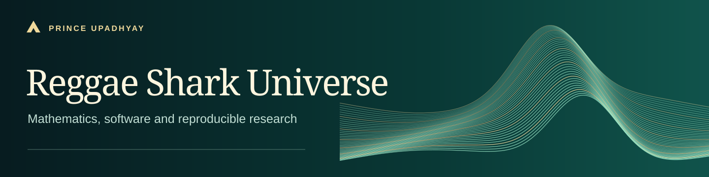

[Projects](#the-public-work) · [Benchmark receipts](#sharkbyte) · [Research archive](#how-to-read-this-archive) · [Clone the source](#one-map-independent-source-histories) · [Researcher profile](https://github.com/reggaesharkk/reggaesharkk)

# Reggae Shark Universe

An independent research portfolio by **Prince Upadhyay**. Explore the software, inspect a computational result, or trace a mathematical claim to its source.

| Explore by field | Starting points |
|---|---|
| Mathematics | [Navier–Stokes](https://github.com/reggaesharkk/navier-stokes-bridge-audit) · [Spectral rank](https://github.com/reggaesharkk/lrsc-odd-ring-spectral-rank) · [Riemann verification](https://github.com/reggaesharkk/riemann-bandwidth1-verification) |
| Languages and verification | [SharkByte](https://github.com/reggaesharkk/SharkByte) · [SharkLang](https://github.com/reggaesharkk/sharklang-v2.4.2-release) · [Reggae Shark Protocol](https://github.com/reggaesharkk/The-Reggae-Shark-Protocol) |
| AI and experimental design | [Self-modeling benchmark](https://github.com/reggaesharkk/psi-self-modeling-benchmark) · [Design Lab](https://github.com/reggaesharkk/self-referential-processing-designlab) |

[Browse all 15 specialist repositories](#the-public-work) · [Pinned revisions](SPECIALIST_REPOSITORIES.md) · [ORCID](https://orcid.org/0009-0002-1170-4487) · [Contact](mailto:starxshark@gmail.com)

## Selected evidence and open questions

### SharkByte

The connected 50-qubit GHZ-family benchmark materialized **4,294,967,296 active states** on disk. Google Compute Engine and Colab recorded matching SHA-256 digests for both the basis and amplitude arrays. [Google Cloud receipt](https://github.com/reggaesharkk/SharkByte/blob/26dae2551b926feae8641bc4bf46c498d03dcc12/evidence/connected-ghz50-gcp/2p32/sharkbyte-ghz50-4b-gcp-receipt.json) · [Colab receipt](https://github.com/reggaesharkk/SharkByte/blob/26dae2551b926feae8641bc4bf46c498d03dcc12/evidence/connected-ghz50-colab/retry-2p32/sharkbyte-connected-ghz50-4294967296-colab.json).

- A 40-qubit, 56-gate support-scaling circuit reached **16,777,216 populated amplitudes**. The independent Cirq comparison checked every populated amplitude in the Colab record; the maximum complex-amplitude difference was **7.40 × 10⁻¹⁹**. The gate graph has **eight disconnected components**, so this is not evidence of a fully connected 40-qubit simulation.
- A separate Windows ARM64 Studio run reached the same state count and recorded **2.77 GiB peak process memory**. The receipt preserves the run’s source revision and dirty-tree status.
- The connected 20-qubit experiment reached **1,048,576 amplitudes**; the documented full-state comparison agreed across four engines, with balanced-cut Schmidt rank **1,024** and entropy **9.005 bits**.
- The Colab suite separately reports **120 seeded Qiskit/Cirq cases through six qubits**, plus connected-circuit and regression checks.

Evidence: [integrated Colab summary](https://github.com/reggaesharkk/SharkByte/blob/15ea5e5df3a4d0dfefafeefe528862f737e2d2c8/evidence/colab-ec876e2/colab-summary.json) · [40-qubit Cirq receipt](https://github.com/reggaesharkk/SharkByte/blob/15ea5e5df3a4d0dfefafeefe528862f737e2d2c8/evidence/colab-ec876e2/cirq-40q-16777216.json) · [Windows Studio receipt](https://github.com/reggaesharkk/SharkByte/blob/15ea5e5df3a4d0dfefafeefe528862f737e2d2c8/evidence/studio_16m/windows_arm64/sharkbyte-85c74d14dcb54040a295e3c2fe422e53.json) · [20-qubit connected-circuit methods](https://github.com/reggaesharkk/SharkByte/blob/15ea5e5df3a4d0dfefafeefe528862f737e2d2c8/docs/high-support-connected-entanglement.md) · [Open integrated notebook in Colab](https://colab.research.google.com/github/reggaesharkk/SharkByte/blob/main/notebooks/SharkByte-Colab-Integrated-Verification.ipynb).

### Riemann and Navier–Stokes

- The Riemann verification and frontier repositories distinguish finite certificates, conditional calculations, model frontiers, and open analytic obligations. The strict **>79%** claim, the WP84 connected aggregate, the A1294 root predicate, and the Riemann Hypothesis all remain **OPEN**.
- Navier–Stokes records establish only specified finite Fourier–Galerkin results. The M14 scalar recurrence is conditional on imported bounds. M15 and continuum regularity remain **OPEN**; a finite computation is not a continuum theorem.

See the [Riemann verification repository](https://github.com/reggaesharkk/riemann-bandwidth1-verification/tree/1c0a8e917fb28bcbc6fedb16866a5a2387112706) and [frontier audit](https://github.com/reggaesharkk/riemann-bandwidth1-frontier-audit/tree/f7af94cd1f2c57186521c662f124f703a1dfcd7d), plus the [Navier–Stokes evidence timeline](https://github.com/reggaesharkk/navier-stokes-bridge-audit/blob/df401d491cf243d937842eb51be1bd1f5ff8c226/notes/NAVIER_STOKES_EVIDENCE_TIMELINE_2026_11_04.md).

## The public work

| Project | Area | Current scope |
|---|---|---|
| [Physics · dynamical sector](https://github.com/reggaesharkk/physics-v1-dynamical-sector) | Mathematical dynamics | Model-specific dynamical-sector and stability work; the observer-to-horizon bridge remains open. |
| [Ψ Self-Modeling Benchmark](https://github.com/reggaesharkk/psi-self-modeling-benchmark) | AI evaluation | Diagnostic self/peer benchmark; it does not establish consciousness or general self-awareness. |
| [Navier–Stokes Bridge Audit](https://github.com/reggaesharkk/navier-stokes-bridge-audit) | Validated computation | Finite Fourier–Galerkin results only. M14 scalar recurrence depends on imported bounds. M15 and continuum regularity remain open. |
| [Self-Referential Processing Design Lab](https://github.com/reggaesharkk/self-referential-processing-designlab) | Experimental design | Preregistered design and simulation validation; confirmatory collection is paused. |
| [LRSC Odd-Ring Spectral Rank](https://github.com/reggaesharkk/lrsc-odd-ring-spectral-rank) | Spectral methods | Scoped odd-ring spectral-rank result and finite eleven-channel certificate. |
| [IntentSeal](https://github.com/reggaesharkk/intentseal) | Verification tooling | Prototype for claim boundaries, evidence provenance, and verification status. |
| [Riemann Bandwidth-One Verification](https://github.com/reggaesharkk/riemann-bandwidth1-verification) | Computational number theory | Finite-band certificates and conditional analyses; strict >79% and the Riemann Hypothesis remain OPEN. |
| [Riemann Bandwidth-One Frontier Audit](https://github.com/reggaesharkk/riemann-bandwidth1-frontier-audit) | Analytic proof frontier | A1294 root predicate and WP84 ordinary-prime connected aggregate remain OPEN; no Riemann Hypothesis proof is claimed. |
| [STRENGTH-B3 Interceptor Core](https://github.com/reggaesharkk/STRENGTH-B3-Interceptor-Core) | AI systems | Research record only; no executable interceptor, training pipeline, or firewall integration. Earlier H4, zero-leakage, and hardware claims are withdrawn. |
| [Strength Intent · Lean](https://github.com/reggaesharkk/strength-intent-ns-lean) | Formal methods | Toy Python/C++ recurrent forward step and narrowly scoped Lean statements; no training or deployment evidence in the public source tree. |
| [Theory of Bounded Existence](https://github.com/reggaesharkk/theory-of-bounded-existence) | Mathematical modeling | Model-specific 4D ODE system and formal artifacts; no physical or consciousness claim. |
| [The Reggae Shark Protocol](https://github.com/reggaesharkk/The-Reggae-Shark-Protocol) | Execution evidence | Application-level verification and signed execution evidence prototype. |
| [SharkLang v2.4.2](https://github.com/reggaesharkk/sharklang-v2.4.2-release) | Governed AI | Approval-gated policy-language/runtime release with an explicit evaluation boundary. |
| [SharkLang Evidence Desk](https://github.com/reggaesharkk/sharklang-evidence-desk) | Release auditing | Local ZIP structure and checksum review; it does not execute archive contents. |
| [SharkByte](https://github.com/reggaesharkk/SharkByte) | Programming languages and simulation | Disk-backed GHZ-family benchmark with matching Colab and Google Cloud array hashes. |

The current public source set contains **15 specialist repositories** and the public profile. Private repositories are excluded. Finite certificates remain finite; simulations do not become observations; prototypes do not become production guarantees. Each source repository states its own assumptions and remaining obligations.

## One map, independent source histories

The project repositories and profile are pinned as Git submodules. This umbrella points to exact source commits without flattening their histories.

```sh
git clone --recurse-submodules https://github.com/reggaesharkk/Reggae-shark-universe-.git
```

For an existing clone:

```sh
git submodule update --init --recursive
```

GitHub’s ordinary “Download ZIP” does not include submodule contents. A recursive clone retrieves the public source trees at the pinned revisions. The complete pin list is in the [live repository map](docs/REPO_MIRROR_INDEX.md).

## How to read this archive

The Executive Map dated 26 October 2026, dossier material, and release notes below are preserved snapshots. They provide provenance; use the current project map above and this claim-boundary checklist for the present source set and status. Counts and research descriptions inside date-labeled sections apply to their named snapshots, not the current repository inventory.

### Collaboration

I value collaboration that begins with a real question, a careful challenge, or another set of eyes. If one of these projects intersects with your work, I welcome a thoughtful note. The repositories show what is established, what is only a prototype, and what remains open.

**Contact:** [starxshark@gmail.com](mailto:starxshark@gmail.com)

---

## Master Research Dossier & Umbrella Standards

- **Consolidated Master Dossier (Programs 01–09):** [`docs/research/Prince_Upadhyay_Master_Research_Dossier_2026-10-24.pdf`](docs/research/Prince_Upadhyay_Master_Research_Dossier_2026-10-24.pdf) (21 pages, `1,127,453` bytes, SHA-256: `3e05c82a3b478a7c15cf510946f4a8a9ad2c929cc1125494d9704966805dc41b`)
- **The Reggae Shark Protocol `v1.3.2` Specification (Program 10 Mirror):** [`docs/research/The_Reggae_Shark_Protocol_v1_3_2_Specification.pdf`](docs/research/The_Reggae_Shark_Protocol_v1_3_2_Specification.pdf) (3 pages, linearized `%PDF-1.4`, `405,584` bytes, SHA-256: `2741d42d619e1037ffd7d00c74ba6f3902cf235d634e6b86bfb6108276688e6f`) alongside the full 31-file source mirror in [`protocols/shark_protocol_v1_3_2/`](protocols/shark_protocol_v1_3_2/).
- **Previous Dossier Editions Preserved in Git History:** `docs/research/Prince_Upadhyay_Complete_Research_Dossier_Oct2026.pdf` (9 Oct 2026, 19 pages) and `Prince_Upadhyay_Master_Research_Dossier_2026-10-01.pdf` (1 Oct 2026, 11 pages).
- **Companion Umbrella Standards & Machine-Readable Registry:**
  - [`RESEARCHER_AND_ARCHIVE_INDEX_2026_10_25.md`](RESEARCHER_AND_ARCHIVE_INDEX_2026_10_25.md) (supersedes `RESEARCHER_AND_ARCHIVE_INDEX_2026_10_24.md` and `RESEARCHER_AND_ARCHIVE_INDEX_2026_10_11.md` additively; indexes `15` OSF DOIs [`13` ORCID-indexed + `2` companion project archives], `17` Zenodo DOIs [`15` version deposits + `2` Concept DOIs], and `10` GitHub repositories)
  - [`PORTFOLIO_EVIDENCE_AND_RIGHTS_STANDARD_2026_10_25.md`](PORTFOLIO_EVIDENCE_AND_RIGHTS_STANDARD_2026_10_25.md) (supersedes `PORTFOLIO_EVIDENCE_AND_RIGHTS_STANDARD_2026_10_24.md` and `PORTFOLIO_EVIDENCE_AND_RIGHTS_STANDARD_2026_10_01.md` additively)
  - [`registry.json`](registry.json) & [`tools/check_umbrella_registry.py`](tools/check_umbrella_registry.py) (automated single-source-of-truth verifier for cross-repository counts, DOIs, and SHA-256 digests)

---

## Executive Map of the Ten Research Programs — 26 October 2026 snapshot

| # | Program | Core Technical Object | Current Verified State (26 Oct 2026) | Evidence Class | Canonical Repository & Primary DOIs |
|---|---|---|---|---|---|
| **01** | **Self-Referential Processing + Design Lab** | Preregistered 260-item, 20-model behavioral protocol (`v8.6.3`) + Phase 7 GLMM architecture validation (`4,000` fits across `500` deterministic replicates) | Phase 7 complete (`M1` passes locked null/coverage screen: `6.6%`/`6.4%` Type-I, `93.4%`/`93.6%` coverage; `M2` fails); `v8.6.3` live confirmatory collection paused/fail-closed | `PREREGISTERED` / `SIMULATED` | [GitHub](https://github.com/reggaesharkk/self-referential-processing-designlab) · [OSF 37H2Y](https://doi.org/10.17605/OSF.IO/37H2Y) · [OSF NV7DZ](https://doi.org/10.17605/OSF.IO/NV7DZ) |
| **02** | **Psi ($\Psi$) Self-Modeling Benchmark** | Controlled deterministic self-vs-peer 2AFC diagnostic benchmark (`p = 0.50` baseline) with style/length/anonymization controls | `v4` pre-confirmatory diagnostic complete; additive hash audit preserves original OSF manifest | `DIAGNOSTIC` / `PREREGISTERED` | [GitHub](https://github.com/reggaesharkk/psi-self-modeling-benchmark) · [OSF N3DQU](https://doi.org/10.17605/OSF.IO/N3DQU) · [OSF 8CFQW](https://doi.org/10.17605/OSF.IO/8CFQW) · [OSF CAE2H](https://doi.org/10.17605/OSF.IO/CAE2H) |
| **03** | **Information-Theoretic Physics & Appendix A v1.5** | 3D open-loop $(\gamma, H, \dot{I})$ dynamical sector, exact 93/28-monomial Hopf positivity (`l_1 > 0`), and Soft-Wall $(\gamma_{\max}, H_{\max})$ dissipative completion | Appendix A `v1.5` certified (`12/12` checks, Lean 4 6-face box invariance, VRK digest `5eb316f2...`); Gate 0 observer-horizon bridge `OPEN` | `PROVED / ANALYTIC` + `CERTIFIED` | [GitHub](https://github.com/reggaesharkk/physics-v1-dynamical-sector) · [Zenodo 23534449](https://doi.org/10.5281/zenodo.23534449) · [OSF TSW4B](https://doi.org/10.17605/OSF.IO/TSW4B) · [OSF U7M6H](https://doi.org/10.17605/OSF.IO/U7M6H) |
| **04** | **LRSC Odd-Ring Spectral Rank** | Single-step near-Nyquist odd-ring operator $\operatorname{rank}(V) = p$ theorem (`v1.2`/`v1.2.2`) + exact $M=99$ subset threshold certificate | Analytic $\operatorname{rank}(V)=p$ theorem proved (`p=41` at $M=99$); `13,432,735,555` subsets enumerated through $K=10$ certifying $K_{0.001}(0.50)=11$ (`margin 409,802,479`) | `PROVED / ANALYTIC` + `CERTIFIED` | [GitHub](https://github.com/reggaesharkk/lrsc-odd-ring-spectral-rank) · [OSF NM5BW](https://doi.org/10.17605/OSF.IO/NM5BW) · [OSF QJFR3](https://doi.org/10.17605/OSF.IO/QJFR3) · [OSF JAK5X](https://doi.org/10.17605/OSF.IO/JAK5X) |
| **05** | **Navier–Stokes Finite-to-Continuum Bridge Audit** | Unforced periodic 3D Navier–Stokes Fourier–Galerkin audits (`WP1–WP19`), prospective K36 gates, and 128-bit Arb same-datum certificates | Certified `N=11..18` same-datum chain (`max error 0.000013774643`); `N17` failed mechanism gate preserved; `WP19 v0.28` adjoint sign fixed; continuum bridge `OPEN` | `CERTIFIED` (finite) / `FALSIFIED` (N17 gate) / `OPEN` (continuum) | [GitHub](https://github.com/reggaesharkk/navier-stokes-bridge-audit) · [Zenodo 22939984](https://doi.org/10.5281/zenodo.22939984) · [Zenodo 23034545](https://doi.org/10.5281/zenodo.23034545) |
| **06** | **IntentSeal + Verifiable Research Kernel (VRK v0.3.1)** | Fail-closed evidence packaging, dual-seal promotion gates, and deterministic claim-boundary verification | IntentSeal prototype freeze (`05ba923c...`) + VRK `v0.3.1` (`c18c4c69...`, `30/30` tests pass, `33/33` adversarial cases rejected) | `CERTIFIED` (software verification infrastructure) | [GitHub](https://github.com/reggaesharkk/intentseal) · [Zenodo 23016445](https://doi.org/10.5281/zenodo.23016445) · [Zenodo 23018459](https://doi.org/10.5281/zenodo.23018459) · [Zenodo 23474505](https://doi.org/10.5281/zenodo.23474505) |
| **07** | **Riemann Bandwidth-One Verification (WP84)** | Discrete Loewner $C^2$ band-truncation theorem (constant `12`), 150-term $C_5$ polyhedral sign certificate, and order-4 filtered counterexamples | Public release `v0.1.0` (`6d799bdd...`, `21/21` CI jobs pass in Run `#37810408337`); `68.820273%` conditional; `79.627%` model consumer; strict `>79%` and RH `OPEN` | `PROVED / ANALYTIC` + `CERTIFIED` (finite) / `OPEN` (zeta limit) | [GitHub](https://github.com/reggaesharkk/riemann-bandwidth1-verification) · [Zenodo 23244818](https://doi.org/10.5281/zenodo.23244818) · [Zenodo 23244817](https://doi.org/10.5281/zenodo.23244817) |
| **08** | **The Theory of Bounded Existence (Appendix B v1.0)** | 4D closed-loop observer ODE $(\gamma, H, \dot{I}, \Psi)$, 17-theorem Lean 4 point-wise boundary suite, exact rational Hopf monotonicity ($de_c/d\mathcal{P}_0 > 0$), and $\Psi$-memory bistability at $\mathcal{P}_0=0$ | Release `v1.0.0` (commit `c690801`, CI Run `#6` green, Reproducibility Digest `80e0724e...`); $\lambda_{\mathrm{lucid},c}(x_0) \approx 0.080341 \to 0.057974$ (`-27.8%`); non-trivial Floquet multipliers `< 10^-8` | `PROVED / ANALYTIC` + `CERTIFIED` (ODE model) | [GitHub](https://github.com/reggaesharkk/theory-of-bounded-existence) · [Zenodo 23608244](https://doi.org/10.5281/zenodo.23608244) |
| **09** | **STRENGTH H4-BRIDGE-1 Audit & Attack Board v0.6** | Exact BPTT gradient audit (`RNN16`/`GRU9`), $D-2$ causal marker SNR collapse, Sheppard's orthant theorem, and Seven-Problem Attack Board `v0.6` | `100` recurrent networks audited (`< 10^-9` finite-difference match); naive $D-2$ marker falsified (`r = -0.023`); prospective LOSO H4 gate & 7 Clay/physics bridges `OPEN` | `PROVED / ANALYTIC` + `FALSIFIED` (naive marker) + `OPEN` | Tracked in [`docs/research/Prince_Upadhyay_Master_Research_Dossier_2026-10-24.pdf`](docs/research/Prince_Upadhyay_Master_Research_Dossier_2026-10-24.pdf) |
| **10** | **The Reggae Shark Protocol (`v1.3.2`)** | 4-layer application verification kernel & multi-tenant AI gateway: Ed25519-signed VRK hash chain & associative Merkle-DAG join, 16-theorem Lean 4 typestate trace FSM (`runTrace`), 4D soft-wall ODE governor (`42` total zero-`sorry` Lean 4 theorems), and bandlimited LRSC $11/99$ context commitment | Release `v1.3.2` (`31` tracked files, `30/30` manifest SHA-256 checks pass, `42/42` unit & verification tests pass, `42` zero-`sorry` Lean 4 theorems across `3` proof modules + `AxiomsCheck.lean` gate) | `PROVED / ANALYTIC` (Lean 4 model) + `CERTIFIED` (application kernel) | [GitHub](https://github.com/reggaesharkk/The-Reggae-Shark-Protocol) · [Concept 23618032](https://doi.org/10.5281/zenodo.23618032) · [Prior v4 23635351](https://doi.org/10.5281/zenodo.23635351) |

---

## October 2026 archival additions (Programs 10, 08 & 03)

### 1. Program 10 — The Reggae Shark Protocol (`v1.3.2`)
- **Archival Lineage (MIT / CC BY 4.0):** Concept DOI [10.5281/zenodo.23618032](https://doi.org/10.5281/zenodo.23618032) (prior version deposits: `v4` [10.5281/zenodo.23635351](https://doi.org/10.5281/zenodo.23635351), `v3` [10.5281/zenodo.23624605](https://doi.org/10.5281/zenodo.23624605), `v2` [10.5281/zenodo.23620074](https://doi.org/10.5281/zenodo.23620074), and `v1` [10.5281/zenodo.23618033](https://doi.org/10.5281/zenodo.23618033)).
- **GitHub Specialist Repository:** [https://github.com/reggaesharkk/The-Reggae-Shark-Protocol](https://github.com/reggaesharkk/The-Reggae-Shark-Protocol) (mirrored in [`protocols/shark_protocol_v1_3_2/`](protocols/shark_protocol_v1_3_2/) and [`docs/research/The_Reggae_Shark_Protocol_v1_3_2_Specification.pdf`](docs/research/The_Reggae_Shark_Protocol_v1_3_2_Specification.pdf)).
- **Key Verified Architecture (`42/42` Tests Passing, `31` Tracked Files):**
  - **42 Zero-`sorry` Machine-Checked Lean 4 Theorems Across 3 Canonical Modules + Axiom-Hygiene Gate (`lean/AxiomsCheck.lean`):**
    - `lean/BoundaryVerification.lean` (`9` theorems, SHA-256: `49229b6163b5a3a77dc83779a7dc5350502ff2b3d6a7f2de4d39996f4460e417`, byte-identical to Program 03 Appendix A `v1.5`).
    - `lean/ExistenceVerification.lean` (`17` theorems, SHA-256: `eec9486803fb2e12f94c3ef966098acd31e4a66df8269ebe8cb59a937f7abcae`, byte-identical to Program 08 Bounded Existence `v1.0.0`).
    - `lean/TypestateLifecycle.lean` (`16` theorems, SHA-256: `3d798bf53652a04d33dcd366475e3b742daa7e894c200cec0b1d91e21140c005`): Proves multi-step inductive trace safety (`runTrace`) over arbitrary event lists, strictly absorbing terminal `ZeroedFreed`, unique canonical path from `Uninit` to `SealedActive` (`sealed_active_unique_trace_from_uninit`), monotonic worker-epoch isolation, Patankar-Euler box invariance (`patankar_euler_step_in_box`, `patankar_strict_positivity_floor`), Grönwall pointwise decay (`psi_decay_floor_bound`), local bounded-domain sensitivity scaling (`lrsc_attention_lipschitz_error_bound`), fence monotonicity (`fence_seq_strict_monotonicity`), associative/commutative/idempotent Merkle-DAG semilattice reconciliation (`merkle_dag_merge_commutative`, `merkle_dag_semilattice_laws`), and `wp19_conservatism_gap_certified`.
    - `lean/AxiomsCheck.lean` & `tools/check_lean_axioms.py` (SHA-256: `b10821dca17fd6e5eceedabeefa566819e8d01fe9d9ddd69282c655860f54110`): Parses `lake env lean lean/AxiomsCheck.lean` output in CI to verify that all `42` theorems emit `depends on axioms: [propext, Classical.choice, Quot.sound]` (or subset) with zero `sorryAx` or custom `axiom` declarations, and verifies exact JSON transition-table parity (`data/lean_transition_table.json`) between Lean 4 and Python.
  - **Ed25519-Signed Ledger, Stateful Subprocess Signer & Signed Head Anti-Truncation Gate (`shark_protocol/kernel.py`):** Requires the OpenSSL-backed `cryptography` library and an explicit external 32-byte seed (`SHARK_ED25519_SEED_HEX`) or a stateful persistent child process (`IsolatedSignerSubprocess(generate_ephemeral=True)`) that keeps the Ed25519 private key outside the parent Python process address space. Permanently revokes and rejects the retired `v1.2.0` default fallback seed (`SHA-256: 914f28eabb2b93fb15bf6ad071120c21e8dd5a8a5e4825f053a1962b101901ec`, public key `e3ad81062fa39a869b798e3ab3a7195316dbe7de0e5e0da22a7ff4194065b74c`). Enforces mandatory `expected_pubkey` pinning in `verify_chain_list`, writes `os.fsync`-flushed `.jsonl` ledgers paired with signed `(head_index, ledger_length, head_hash, issued_at)` `.head.json` files, and provides `SharkProtocolEngine.verify_exported_ledger` (`data/release_head.json`, reference head hash `866e1919b5a3e9e1e896496f735fdc94846e03497533b74f6fe3a5a96608ee5b`) to detect tail truncation and rollback.
  - **Fail-Closed Token-Bound Multi-Tenant Gateway & Hardened HTTP Server (`shark_protocol/gateway.py`):** Binds each Bearer token hash (`sha256(token)`) to its authorized `tenant_id` via `token_registry` on both loopback and remote binds, prevents cross-tenant forgery (HTTP `403`), preserves active tenant state across LRU capacity bounds (`max_tenants=128`), offloads synchronous HTTP provider transport via `asyncio.to_thread` in `dispatch_async`, enforces `MAX_HTTP_CONTENT_LENGTH = 65536` (HTTP `413`), and sanitizes HTTP `500` error responses.

### 2. Program 08 — The Theory of Bounded Existence (`Appendix B v1.0`)
- **Zenodo Deposit (CC BY 4.0 / MIT):** [https://doi.org/10.5281/zenodo.23608244](https://doi.org/10.5281/zenodo.23608244)
- **GitHub Repository (MIT):** [https://github.com/reggaesharkk/theory-of-bounded-existence](https://github.com/reggaesharkk/theory-of-bounded-existence) (Tag `v1.0.0`, CI Run [`#6` (`24822460015`)](https://github.com/reggaesharkk/theory-of-bounded-existence/actions/runs/24822460015) at commit `c690801`)
- **Key Verified Findings:**
  - **Lean 4 Point-Wise Boundary Verification (`ExistenceVerification.lean`, SHA-256 `eec9486803fb2e12f94c3ef966098acd31e4a66df8269ebe8cb59a937f7abcae`):** Zero-`sorry` formalization of all 17 theorems covering the 8 hyper-rectangular faces of $\mathcal{B}_4 = [0,\gamma_{\max}] \times [0,H_{\max}] \times [0,\dot{I}_{\max,4\mathrm{D}}] \times [0,1]$, combined with classical Nagumo subtangentiality and Grönwall differential inequalities.
  - **Exact Rational Hopf Algebra:** Open-loop $de_c/d\mathcal{P}_0 = \mathcal{N}_7(\mathcal{P}_0)/\mathcal{D}_7(\mathcal{P}_0) > 0$ across all $\mathcal{P}_0 > 10/99$.
  - **$\Psi$-Memory-Sustained Zero-Drive Bistability ($\mathcal{P}_0 = 0$):** At $\mathcal{P}_0 = 0$, the origin $E_0 = (0,0,0,0)$ is locally asymptotically stable with exact Jacobian eigenvalues $\{-0.105573, -1.894427, -200.0, -0.60\}$, coexisting with an interior periodic limit cycle ($T_{\mathrm{IVb}} = 19.6852\,\mathrm{s}$, $T_{\mathrm{IVc}} = 19.3871\,\mathrm{s}$).
  - **Reproducibility Digest:** `80e0724e98e68de288ef0e0feb5d77cddc905f7d1d302451900d38bdc953e12d`.

### 3. Program 03 — Information-Theoretic Physics (`Appendix A v1.5` Soft-Wall Completion)
- **Zenodo Deposit:** [https://doi.org/10.5281/zenodo.23534449](https://doi.org/10.5281/zenodo.23534449) (superseding `10.5281/zenodo.23497142` and `10.5281/zenodo.23501526` additively)
- **GitHub Repository:** [https://github.com/reggaesharkk/physics-v1-dynamical-sector](https://github.com/reggaesharkk/physics-v1-dynamical-sector) (CI Run `#39587627124` at commit `4211c6f`)
- **Key Verified Findings:**
  - Resolves post-Hopf runaway trajectories via smooth hyperbolic-tangent gates, establishing a compact positively invariant box $\mathcal{B}(e) = [0,\gamma_{\max}] \times [0,H_{\max}] \times [0,\dot{I}_{\max}(e)]$ with Lean 4 6-face boundary verification (`BoundaryVerification.lean`, SHA-256 `49229b6163b5a3a77dc83779a7dc5350502ff2b3d6a7f2de4d39996f4460e417`) and VRK v0.3.1 Certificate Digest `5eb316f25edef8e711db7ddec88224172a9cadd8cf7d332457dfa596f4368117`.

---

## Software release — SharkLang v2.4.2 (1 November 2026)

I built SharkLang as a small policy language and runtime for examining an approval-gated AI request flow. The v2.4.2 archive is a security-review release. Its demo makes real provider calls only when I run it with `--live`; the purchase amount and spending cap are simulated inputs and no payment is processed.

- **GitHub:** [source, release archive and validation workflow](https://github.com/reggaesharkk/sharklang-v2.4.2-release)
- **Zenodo:** [10.5281/zenodo.23841845](https://doi.org/10.5281/zenodo.23841845)
- **Rights:** I reserve commercial and production use under the [SharkLang Evaluation License 1.0](https://github.com/reggaesharkk/sharklang-v2.4.2-release/blob/main/EVALUATION_LICENSE.txt).

## Global Claim-Boundary Checklist

**Current as of 18 November 2026.** The dated Executive Map and release sections above remain historical snapshots; the current repository map and the notes below describe the present claim boundaries.

| Question | Current portfolio answer |
|---|---|
| **Does the portfolio contain rigorous mathematical results?** | Yes. It includes scoped analytic results and finite certificates. Each specialist repository states its assumptions and evidence class; these results do not close the open claims listed here. |
| **Does the Navier–Stokes work solve 3D continuum regularity?** | No. The current work establishes finite Fourier–Galerkin results only. **M14/M15 remain STOP** and continuum regularity remains **OPEN**. The main record reports an M15 conservative remainder of about `1.64 × 10¹⁴`, above the signed lower bound of about `5.76 × 10⁹`; the targeted steps 220–239 reduction is not independently reproduced. See the [current evidence timeline](https://github.com/reggaesharkk/navier-stokes-bridge-audit/blob/df401d491cf243d937842eb51be1bd1f5ff8c226/notes/NAVIER_STOKES_EVIDENCE_TIMELINE_2026_11_04.md). |
| **Does the Riemann work prove the Riemann Hypothesis or an unconditional strict >79% result?** | No. `68.820273%` is conditional, `79.627%` is a model frontier, and strict **>79%**, the WP84 ordinary-prime connected aggregate, the A1294 root predicate, and the Riemann Hypothesis remain **OPEN**. See the [verification repository](https://github.com/reggaesharkk/riemann-bandwidth1-verification/tree/1c0a8e917fb28bcbc6fedb16866a5a2387112706) and [frontier audit](https://github.com/reggaesharkk/riemann-bandwidth1-frontier-audit/tree/f7af94cd1f2c57186521c662f124f703a1dfcd7d). |
| **What did the early 40-qubit support-scaling benchmark check?** | Its 40-qubit, 16,777,216-state support-scaling circuit has eight disconnected components. Cirq checked every populated amplitude for that circuit. Separately, the connected 20-qubit experiment reached 1,048,576 amplitudes and has a documented four-engine statevector comparison and entanglement witness. These are simulator results, not quantum-hardware runs. See the [SharkByte evidence](https://github.com/reggaesharkk/SharkByte/tree/15ea5e5df3a4d0dfefafeefe528862f737e2d2c8/evidence/colab-ec876e2/). |
| **Do the Physics or Bounded Existence models establish a microscopic law of nature or machine sentience?** | No. They are model-specific ODE systems. The observer-to-horizon bridge remains open; model readouts are not claims of subjective consciousness. |
| **Do the AI behavioral projects establish LLM self-awareness?** | No. The Ψ benchmark is diagnostic and does not establish consciousness. Confirmatory collection in the Self-Referential Processing Design Lab is paused. |
| **Are the public STRENGTH projects deployable security systems?** | No. The B3 repository is a research record without an executable interceptor, training pipeline, or firewall integration. Earlier H4, zero-leakage, and hardware claims are withdrawn. The Lean companion contains a toy recurrent-step prototype and narrowly scoped formal statements, not training or deployment evidence. |
| **Are failed or unevaluable prospective gates preserved?** | Yes. The specialist repositories retain failed and inconclusive outcomes with their stated limits; the portfolio does not convert them into positive results through post-hoc retuning. |

---

## Repository Contents & Navigation

- [Live public repository map](docs/REPO_MIRROR_INDEX.md) — 15 public specialist repositories, source links, and exact pinned commits.
- [Current claim-boundary checklist](#global-claim-boundary-checklist) — current evidence limits and open obligations.
- [Specialist repository list](SPECIALIST_REPOSITORIES.md) — current source set and clone instructions.
- [Pinned source tree directory](public-repositories/README.md) — how to retrieve the submodules with their contents.
- [Research dossier and historical evidence](#master-research-dossier--umbrella-standards) — dated records preserved in this archive.
- [Machine-readable registry](registry.json) and [registry checker](tools/check_umbrella_registry.py) — historical DOI/evidence registry and its consistency checker.
- [Repository SHA-256 manifest](MANIFEST_SHA256.txt) — hashes for tracked Umbrella files; it does not hash itself.

> **Security & Key-Pinning Note (`v1.3.2` vs Historical `v1.2.0`):** Historical archive deposit `v4` (`10.5281/zenodo.23635351`, `v1.2.0`) included a deterministic fallback Ed25519 seed (`SHA-256: 914f28eabb2b93fb15bf6ad071120c21e8dd5a8a5e4825f053a1962b101901ec`, public key `e3ad81062fa39a869b798e3ab3a7195316dbe7de0e5e0da22a7ff4194065b74c`). That seed is **permanently revoked** in `v1.3.2`: `Ed25519AuthoritySigner` requires `cryptography` and an explicit external `SHARK_ED25519_SEED_HEX` (or `IsolatedSignerSubprocess(generate_ephemeral=True)`), and `SharkProtocolEngine.verify_chain_list(..., *, expected_pubkey=...)` and `verify_exported_ledger` require a pinned verifier public key (`protocols/shark_protocol_v1_3_2/SECURITY.md`, `registry.json`).
