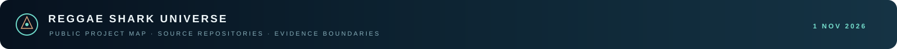

<p align="center"></p>

# Specialist repositories

**Updated:** 1 November 2026.

I keep the project work in specialist repositories and use this Umbrella as the cross-project map and archive. The table below is the current public set; the listed source commits are pinned as Git submodules under `public-repositories/`.

## Current public source set

| # | Project | Repository | Scope note | Pinned commit |
|---:|---|---|---|---|
| 1 | Physics · dynamical sector | [physics-v1-dynamical-sector](https://github.com/reggaesharkk/physics-v1-dynamical-sector) | Model-specific dynamical-sector and stability work. The observer-to-horizon bridge remains open. | `c579bcd55b6d31549729b038159e02746375b000` |
| 2 | Ψ Self-Modeling Benchmark | [psi-self-modeling-benchmark](https://github.com/reggaesharkk/psi-self-modeling-benchmark) | Diagnostic self/peer benchmark. It does not establish consciousness or general self-awareness. | `3c76eea6b0d64e11f9e7bc18eeb8f69e87f0e1cf` |
| 3 | Navier–Stokes Bridge Audit | [navier-stokes-bridge-audit](https://github.com/reggaesharkk/navier-stokes-bridge-audit) | Finite Fourier–Galerkin certificates; transfer to continuum regularity remains open. | `def4df60b0ebdce8b0c99cea6006eb2905e0e02f` |
| 4 | Self-Referential Processing Design Lab | [self-referential-processing-designlab](https://github.com/reggaesharkk/self-referential-processing-designlab) | Preregistered design and simulation validation; confirmatory collection is paused. | `10edbe34f1df741cfb4e7f3a7bb0dff4073e6186` |
| 5 | LRSC Odd-Ring Spectral Rank | [lrsc-odd-ring-spectral-rank](https://github.com/reggaesharkk/lrsc-odd-ring-spectral-rank) | Scoped odd-ring spectral-rank result and finite eleven-channel certificate. | `39db6e6bebcd364462605048f71933da4f8681a5` |
| 6 | IntentSeal | [intentseal](https://github.com/reggaesharkk/intentseal) | Prototype for claim boundaries, evidence provenance, and verification status. | `bb01fbe07b8e8a0a6d172370793937e9785fd7ab` |
| 7 | Riemann Bandwidth-One Verification | [riemann-bandwidth1-verification](https://github.com/reggaesharkk/riemann-bandwidth1-verification) | Finite-band certificates and conditional analyses; the Riemann Hypothesis remains open. | `4cec55eb89ddcdfac8f1b06ecec28b06632973d8` |
| 8 | STRENGTH-B3 Interceptor Core | [STRENGTH-B3-Interceptor-Core](https://github.com/reggaesharkk/STRENGTH-B3-Interceptor-Core) | Windows ARM64 interceptor prototype; claims remain bounded by the repository’s measured scope. | `501bcffed22ed2b51e66762a5a287a92aa19a406` |
| 9 | Strength Intent · Lean | [strength-intent-ns-lean](https://github.com/reggaesharkk/strength-intent-ns-lean) | Separate Lean-oriented companion in the STRENGTH research line; see its repository for current scope. | `e4a5f717ac495f30123f82ebfb2cc3c9958034b0` |
| 10 | Theory of Bounded Existence | [theory-of-bounded-existence](https://github.com/reggaesharkk/theory-of-bounded-existence) | Model-specific 4D ODE system and formal artifacts; no physical or consciousness claim. | `5bc839e6e0cf492882268d8ed47bef6ff82d65fc` |
| 11 | The Reggae Shark Protocol | [The-Reggae-Shark-Protocol](https://github.com/reggaesharkk/The-Reggae-Shark-Protocol) | Application-level verification and signed execution evidence prototype. | `1d7cce4f1071eda63b6d19a79267902adb37ea0a` |
| 12 | SharkLang v2.4.2 | [sharklang-v2.4.2-release](https://github.com/reggaesharkk/sharklang-v2.4.2-release) | Approval-gated policy-language/runtime release with an explicit evaluation boundary. | `622a88fe2cc205b752e8c6cc2c5b1702a4c05487` |
| 13 | SharkLang Evidence Desk | [sharklang-evidence-desk](https://github.com/reggaesharkk/sharklang-evidence-desk) | Local ZIP structure and checksum review; it does not execute archive contents. | `0963f5a5d360456ff724c4d8657aca461a4f1b68` |

The account profile and CV are also included as a pinned public submodule at `public-repositories/profile`: [reggaesharkk](https://github.com/reggaesharkk) · `190960ae06ec145fe532fdf118f7890f36960ad7`.

## Retrieve the source set

```sh
git clone --recurse-submodules https://github.com/reggaesharkk/Reggae-shark-universe-.git
```

The umbrella stores commit pointers, while each specialist repository remains the authoritative source for its own files and history. GitHub’s ordinary “Download ZIP” archive does not include submodule contents; clone with `--recurse-submodules` to retrieve them.

This current list covers the public repositories only. Private repositories remain private and are not copied here.
