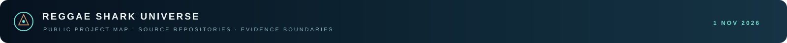

<p align="center"></p>

# Specialist repositories

**Updated:** 26 November 2026.

This umbrella indexes the public projects and pins each source repository as a Git submodule under `public-repositories/`. Each specialist repository remains the authority for its own source, history, license, evidence, and project-specific scope.

## Current public source set

| # | Project | Repository | Scope note | Pinned commit |
|---:|---|---|---|---|
| 1 | Physics · dynamical sector | [physics-v1-dynamical-sector](https://github.com/reggaesharkk/physics-v1-dynamical-sector) | Model-specific dynamical-sector and stability work; the observer-to-horizon bridge remains open. | `0527f0c016dfa310ada17573967f16788c6bcb26` |
| 2 | Ψ Self-Modeling Benchmark | [psi-self-modeling-benchmark](https://github.com/reggaesharkk/psi-self-modeling-benchmark) | I keep the v5.0 diagnostic release and one live Colab run here; the release does not record an exact external API-call count. | `66611751920e782c58207abfada6f98df7cd959b` |
| 3 | Navier–Stokes Bridge Audit | [navier-stokes-bridge-audit](https://github.com/reggaesharkk/navier-stokes-bridge-audit) | Finite Fourier–Galerkin results only. M14 scalar recurrence depends on imported bounds. M15 and continuum regularity remain open. | `df401d491cf243d937842eb51be1bd1f5ff8c226` |
| 4 | Self-Referential Processing Design Lab | [self-referential-processing-designlab](https://github.com/reggaesharkk/self-referential-processing-designlab) | I keep five Pilot B receipts (317 calls; USD 0.01926445), one Pilot A receipt (540 HTTP 200 calls; USD 0.04127526), and one partial confirmatory receipt (180 responses: 176 HTTP 200, four HTTP 402; USD 0.01704482). Qwen completed 27 items before the credit boundary; the 260-item run is not complete. | `c9850fd96d106f32486acd255c8d7e8e8dbc3bd3` |
| 5 | LRSC Odd-Ring Spectral Rank | [lrsc-odd-ring-spectral-rank](https://github.com/reggaesharkk/lrsc-odd-ring-spectral-rank) | Scoped odd-ring spectral-rank result and finite eleven-channel certificate. | `39db6e6bebcd364462605048f71933da4f8681a5` |
| 6 | IntentSeal | [intentseal](https://github.com/reggaesharkk/intentseal) | Prototype for claim boundaries, evidence provenance, and verification status. | `bb01fbe07b8e8a0a6d172370793937e9785fd7ab` |
| 7 | Riemann Bandwidth-One Verification | [riemann-bandwidth1-verification](https://github.com/reggaesharkk/riemann-bandwidth1-verification) | Finite-band certificates and conditional analyses; strict >79% and the Riemann Hypothesis remain OPEN. | `81f3aa6f605d8e8ac0978da50d0512d108f784da` |
| 8 | Riemann Bandwidth-One Frontier Audit | [riemann-bandwidth1-frontier-audit](https://github.com/reggaesharkk/riemann-bandwidth1-frontier-audit) | A1294 root predicate and WP84 ordinary-prime connected aggregate remain OPEN; no Riemann Hypothesis proof is claimed. | `f7af94cd1f2c57186521c662f124f703a1dfcd7d` |
| 9 | STRENGTH-B3 Interceptor Core | [STRENGTH-B3-Interceptor-Core](https://github.com/reggaesharkk/STRENGTH-B3-Interceptor-Core) | Research record only; no executable interceptor, training pipeline, or firewall integration. Earlier H4, zero-leakage, and hardware claims are withdrawn. | `d48d98e950e9163efbe6a60dfe4b0b5625b74307` |
| 10 | Strength Intent · Lean | [strength-intent-ns-lean](https://github.com/reggaesharkk/strength-intent-ns-lean) | Toy Python/C++ recurrent forward step and narrowly scoped Lean statements; no training or deployment evidence in the public source tree. | `0ed31d77943d38e1b8ad04a476628dbe0f851cf5` |
| 11 | Theory of Bounded Existence | [theory-of-bounded-existence](https://github.com/reggaesharkk/theory-of-bounded-existence) | Model-specific 4D ODE system and formal artifacts; no physical or consciousness claim. | `5bc839e6e0cf492882268d8ed47bef6ff82d65fc` |
| 12 | The Reggae Shark Protocol | [The-Reggae-Shark-Protocol](https://github.com/reggaesharkk/The-Reggae-Shark-Protocol) | Application-level verification and signed execution evidence prototype. | `9ae4784233e1cb148426232af7dee667a4393b4d` |
| 13 | SharkLang v2.4.2 | [sharklang-v2.4.2-release](https://github.com/reggaesharkk/sharklang-v2.4.2-release) | Approval-gated policy-language/runtime release with an explicit evaluation boundary. | `622a88fe2cc205b752e8c6cc2c5b1702a4c05487` |
| 14 | SharkLang Evidence Desk | [sharklang-evidence-desk](https://github.com/reggaesharkk/sharklang-evidence-desk) | Local ZIP structure and checksum review; it does not execute archive contents. | `5c5156b886bb2d3b24a9207793c6bb0c67baefdb` |
| 15 | SharkByte | [SharkByte](https://github.com/reggaesharkk/SharkByte) | Disk-backed GHZ-family benchmark with matching Colab and Google Cloud array hashes. | `9ff067d44f792f87624a9b546fb917543b5c9b6e` |

The public account profile and research CV are also pinned at `public-repositories/profile`: [reggaesharkk](https://github.com/reggaesharkk) · `e42f14d1dc5602775534eec5683b6171c39e641e`.

## Retrieve the source set

```sh
git clone --recurse-submodules https://github.com/reggaesharkk/Reggae-shark-universe-.git
```

For an existing clone:

```sh
git submodule update --init --recursive
```

The umbrella stores commit pointers, while each specialist repository keeps its own files and Git history. GitHub’s normal ZIP download contains the gitlink records but not the submodule contents; use a recursive clone to retrieve the pinned source trees.

This index covers the **15 public specialist repositories** and the public profile. Private repositories are excluded from this public map.
