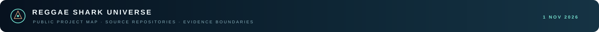

<p align="center"></p>

# Public repository map

**Updated:** 4 November 2026.

This is the current index of the public source repositories connected to the Reggae Shark Universe. Each specialist repository keeps its own history, issues, license, and project-specific evidence. The Umbrella records the source commit it points to. The Navier–Stokes [4 November timeline](../papers/navier-stokes/NAVIER_STOKES_EVIDENCE_TIMELINE_2026_11_04.md) and [N14/Actions audit note](../papers/navier-stokes/WP19_N14_ARM64_CERTIFICATE_AND_ACTIONS_AUDIT_2026_11_04.md) document the latest finite-cutoff update. Specialist PR #167 merged as source commit `43d9bbf1b9dd1d47fa6ee60793e4c54d749af0ea`; the source pin below reflects that merged audit update.

I keep the boundary beside the link: a finite result is not a universal theorem; a diagnostic benchmark is not a consciousness finding; a prototype is not a production security certification.

## Public project repositories

| Project | Area | Evidence boundary | Pinned source commit |
|---|---|---|---|
| [Physics · dynamical sector](https://github.com/reggaesharkk/physics-v1-dynamical-sector) | Mathematical dynamics | Model-specific dynamical-sector and stability work. The observer-to-horizon bridge remains open. | `c579bcd55b6d31549729b038159e02746375b000` |
| [Ψ Self-Modeling Benchmark](https://github.com/reggaesharkk/psi-self-modeling-benchmark) | AI evaluation | Diagnostic self/peer benchmark. It does not establish consciousness or general self-awareness. | `3c76eea6b0d64e11f9e7bc18eeb8f69e87f0e1cf` |
| [Navier–Stokes Bridge Audit](https://github.com/reggaesharkk/navier-stokes-bridge-audit) | Validated computation | Finite Fourier–Galerkin certificates; transfer to continuum regularity remains open. | `43d9bbf1b9dd1d47fa6ee60793e4c54d749af0ea` |
| [Self-Referential Processing Design Lab](https://github.com/reggaesharkk/self-referential-processing-designlab) | Experimental design | Preregistered design and simulation validation; confirmatory collection is paused. | `10edbe34f1df741cfb4e7f3a7bb0dff4073e6186` |
| [LRSC Odd-Ring Spectral Rank](https://github.com/reggaesharkk/lrsc-odd-ring-spectral-rank) | Spectral methods | Scoped odd-ring spectral-rank result and finite eleven-channel certificate. | `39db6e6bebcd364462605048f71933da4f8681a5` |
| [IntentSeal](https://github.com/reggaesharkk/intentseal) | Verification tooling | Prototype for claim boundaries, evidence provenance, and verification status. | `bb01fbe07b8e8a0a6d172370793937e9785fd7ab` |
| [Riemann Bandwidth-One Verification](https://github.com/reggaesharkk/riemann-bandwidth1-verification) | Computational number theory | Finite-band certificates and conditional analyses; the Riemann Hypothesis remains open. | `4cec55eb89ddcdfac8f1b06ecec28b06632973d8` |
| [STRENGTH-B3 Interceptor Core](https://github.com/reggaesharkk/STRENGTH-B3-Interceptor-Core) | AI systems | Windows ARM64 interceptor prototype; claims remain bounded by the repository’s measured scope. | `501bcffed22ed2b51e66762a5a287a92aa19a406` |
| [Strength Intent · Lean](https://github.com/reggaesharkk/strength-intent-ns-lean) | Formal methods | Separate Lean-oriented companion in the STRENGTH research line; see its repository for current scope. | `e4a5f717ac495f30123f82ebfb2cc3c9958034b0` |
| [Theory of Bounded Existence](https://github.com/reggaesharkk/theory-of-bounded-existence) | Mathematical modeling | Model-specific 4D ODE system and formal artifacts; no physical or consciousness claim. | `5bc839e6e0cf492882268d8ed47bef6ff82d65fc` |
| [The Reggae Shark Protocol](https://github.com/reggaesharkk/The-Reggae-Shark-Protocol) | Execution evidence | Application-level verification and signed execution evidence prototype. | `1d7cce4f1071eda63b6d19a79267902adb37ea0a` |
| [SharkLang v2.4.2](https://github.com/reggaesharkk/sharklang-v2.4.2-release) | Governed AI | Approval-gated policy-language/runtime release with an explicit evaluation boundary. | `622a88fe2cc205b752e8c6cc2c5b1702a4c05487` |
| [SharkLang Evidence Desk](https://github.com/reggaesharkk/sharklang-evidence-desk) | Release auditing | Local ZIP structure and checksum review; it does not execute archive contents. | `0963f5a5d360456ff724c4d8657aca461a4f1b68` |

## Profile

[Prince Upadhyay — profile and research CV](https://github.com/reggaesharkk/reggaesharkk) · pinned commit `190960ae06ec145fe532fdf118f7890f36960ad7`

## Clone the complete public source set

The submodule entries under `public-repositories/` pin the repositories above and the profile repository. Clone the Umbrella with:

```sh
git clone --recurse-submodules https://github.com/reggaesharkk/Reggae-shark-universe-.git
```

If you already cloned it without submodules:

```sh
git submodule update --init --recursive
```

A normal clone contains the pinned links but not the contents of the source repositories. The command above retrieves the pinned source trees. Private projects are not included in this public map.
