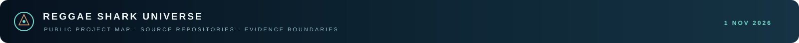

<p align="center"></p>

# Public repository map

**Updated:** 16 November 2026.

This is the current index of public source repositories connected to the Reggae Shark Universe. Each specialist repository keeps its own history, issues, license, and project evidence. This umbrella pins the default-branch commit selected for each public source on this date.

The Navier–Stokes [evidence timeline](https://github.com/reggaesharkk/navier-stokes-bridge-audit/blob/df401d491cf243d937842eb51be1bd1f5ff8c226/notes/NAVIER_STOKES_EVIDENCE_TIMELINE_2026_11_04.md) records finite-cutoff results and the current M14/M15 and continuum boundaries. The Riemann verification and frontier repositories state separate finite, conditional, model, and open obligations. No open mathematical claim is upgraded here.

I keep scope beside the links: a finite result is not a universal theorem; a diagnostic benchmark is not a consciousness finding; a prototype is not a production security certification.

## Public project repositories

| Project | Area | Evidence boundary | Pinned source commit |
|---|---|---|---|
| [Physics · dynamical sector](https://github.com/reggaesharkk/physics-v1-dynamical-sector) | Mathematical dynamics | Model-specific dynamical-sector and stability work; the observer-to-horizon bridge remains open. | `c579bcd55b6d31549729b038159e02746375b000` |
| [Ψ Self-Modeling Benchmark](https://github.com/reggaesharkk/psi-self-modeling-benchmark) | AI evaluation | Diagnostic self/peer benchmark; it does not establish consciousness or general self-awareness. | `3c76eea6b0d64e11f9e7bc18eeb8f69e87f0e1cf` |
| [Navier–Stokes Bridge Audit](https://github.com/reggaesharkk/navier-stokes-bridge-audit) | Validated computation | Finite Fourier–Galerkin results only. M14/M15 remain STOP; continuum regularity remains OPEN. | `df401d491cf243d937842eb51be1bd1f5ff8c226` |
| [Self-Referential Processing Design Lab](https://github.com/reggaesharkk/self-referential-processing-designlab) | Experimental design | Preregistered design and simulation validation; confirmatory collection is paused. | `10edbe34f1df741cfb4e7f3a7bb0dff4073e6186` |
| [LRSC Odd-Ring Spectral Rank](https://github.com/reggaesharkk/lrsc-odd-ring-spectral-rank) | Spectral methods | Scoped odd-ring spectral-rank result and finite eleven-channel certificate. | `39db6e6bebcd364462605048f71933da4f8681a5` |
| [IntentSeal](https://github.com/reggaesharkk/intentseal) | Verification tooling | Prototype for claim boundaries, evidence provenance, and verification status. | `bb01fbe07b8e8a0a6d172370793937e9785fd7ab` |
| [Riemann Bandwidth-One Verification](https://github.com/reggaesharkk/riemann-bandwidth1-verification) | Computational number theory | Finite-band certificates and conditional analyses; strict >79% and the Riemann Hypothesis remain OPEN. | `1c0a8e917fb28bcbc6fedb16866a5a2387112706` |
| [Riemann Bandwidth-One Frontier Audit](https://github.com/reggaesharkk/riemann-bandwidth1-frontier-audit) | Analytic proof frontier | A1294 root predicate and WP84 ordinary-prime connected aggregate remain OPEN; no Riemann Hypothesis proof is claimed. | `f7af94cd1f2c57186521c662f124f703a1dfcd7d` |
| [STRENGTH-B3 Interceptor Core](https://github.com/reggaesharkk/STRENGTH-B3-Interceptor-Core) | AI systems | Research record only; no executable interceptor, training pipeline, or firewall integration. Earlier H4, zero-leakage, and hardware claims are withdrawn. | `d48d98e950e9163efbe6a60dfe4b0b5625b74307` |
| [Strength Intent · Lean](https://github.com/reggaesharkk/strength-intent-ns-lean) | Formal methods | Toy Python/C++ recurrent forward step and narrowly scoped Lean statements; no training or deployment evidence in the public source tree. | `0ed31d77943d38e1b8ad04a476628dbe0f851cf5` |
| [Theory of Bounded Existence](https://github.com/reggaesharkk/theory-of-bounded-existence) | Mathematical modeling | Model-specific 4D ODE system and formal artifacts; no physical or consciousness claim. | `5bc839e6e0cf492882268d8ed47bef6ff82d65fc` |
| [The Reggae Shark Protocol](https://github.com/reggaesharkk/The-Reggae-Shark-Protocol) | Execution evidence | Application-level verification and signed execution evidence prototype. | `1d7cce4f1071eda63b6d19a79267902adb37ea0a` |
| [SharkLang v2.4.2](https://github.com/reggaesharkk/sharklang-v2.4.2-release) | Governed AI | Approval-gated policy-language/runtime release with an explicit evaluation boundary. | `622a88fe2cc205b752e8c6cc2c5b1702a4c05487` |
| [SharkLang Evidence Desk](https://github.com/reggaesharkk/sharklang-evidence-desk) | Release auditing | Local ZIP structure and checksum review; it does not execute archive contents. | `0963f5a5d360456ff724c4d8657aca461a4f1b68` |
| [SharkByte](https://github.com/reggaesharkk/SharkByte) | Programming languages and simulation | See the bounded benchmark and independent-reference results below. | `15ea5e5df3a4d0dfefafeefe528862f737e2d2c8` |

## Profile

[Prince Upadhyay — profile and research CV](https://github.com/reggaesharkk/reggaesharkk) · pinned commit `190960ae06ec145fe532fdf118f7890f36960ad7`

## Clone the complete public source set

The submodules under `public-repositories/` pin the public specialist repositories and the profile repository. Clone the umbrella with:

```sh
git clone --recurse-submodules https://github.com/reggaesharkk/Reggae-shark-universe-.git
```

If you already cloned it without submodules:

```sh
git submodule update --init --recursive
```

A normal clone contains the pinned links but not the contents of the source repositories. Private repositories are excluded from this public map.
